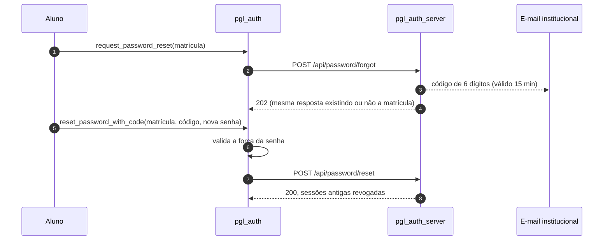
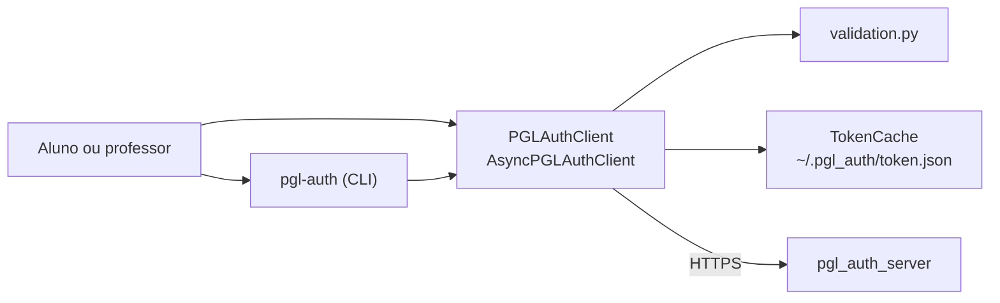

# pgl_auth

    

Cliente Python para a autenticação dos alunos da disciplina. Ele cadastra a senha, faz
login e devolve o token JWT (válido por 4 horas) usado no proxy dos modelos de IA. Também
cobre a troca e a redefinição de senha por e-mail, e a gestão da turma para professores.

A API que valida tudo vive no repositório [`pgl_auth_server`](../pgl_auth_server). Nenhuma
credencial do banco fica no pacote instalado pelos alunos.

## Instalação

```bash
pip install pgl-auth
```

## Uso pelo aluno

Cadastro: matrícula, e-mail institucional, senha e confirmação são todos obrigatórios.
O e-mail precisa ser o que está no roster da disciplina.

```python
from pgl_auth import PGLAuthClient

client = PGLAuthClient()

client.register(
    "2021012345",
    "2021012345@pucminas.edu.br",
    "Minha@Senha2026",
    "Minha@Senha2026",
)

token = client.login("2021012345", "Minha@Senha2026")
headers = client.auth_header()  # {"Authorization": "Bearer <token>"}
```

Troca de senha, sabendo a senha atual. A sessão continua aberta e os tokens antigos
deixam de valer:

```python
client.change_password("Minha@Senha2026", "Outra@Senha2027")
```

Esqueci a senha. O código de 6 dígitos vai para o e-mail institucional e vale 15 minutos:

```python
client.request_password_reset("2021012345")
client.reset_password_with_code("2021012345", "123456", "Outra@Senha2027")
```

Sessão salva em disco, para não pedir a senha em cada uso, e encerramento dela:

```python
from pgl_auth import PGLAuthClient, TokenCache

client = PGLAuthClient(token_cache=TokenCache())
client.login("2021012345", "Outra@Senha2027")       # salva ~/.pgl_auth/token.json

client = PGLAuthClient(token_cache=TokenCache())
client.restore_session("2021012345")                 # carrega o token salvo
client.logout()                                      # revoga e apaga o arquivo
```

Versão assíncrona, para programas com `asyncio`:

```python
import asyncio
from pgl_auth import AsyncPGLAuthClient

async def main():
    client = AsyncPGLAuthClient()
    await client.login("2021012345", "Outra@Senha2027")

asyncio.run(main())
```

Erros são exceções do pacote, todas derivadas de `PGLAuthError`:

| Exceção | Quando acontece |
| --- | --- |
| `InvalidInputError` | Matrícula, e-mail ou senha fora das regras. A lista `problems` diz o que falhou. Nenhuma requisição é enviada. |
| `AuthenticationError` | Matrícula ou senha incorretas. |
| `InactiveAccountError` | Conta bloqueada, ou aluno não matriculado ou inativo. |
| `AlreadyRegisteredError` | A matrícula já tem senha. |
| `RateLimitedError` | Muitas tentativas erradas. A conta fica bloqueada por 15 minutos. |
| `InvalidResetCodeError` | Código errado, vencido, ou com tentativas esgotadas. |
| `SessionExpiredError` | Token ausente, vencido ou revogado. |
| `PermissionDeniedError` | Ação restrita a professores. |

## Uso pelo professor

Professores fazem login normalmente. Depois, podem:

```python
client.list_students()                              # turma e estado de cada conta
client.set_student_status("2021012345", False)      # bloqueia a conta
client.send_invitations(["2021012345", "2021012346"])  # convida quem não tem senha
client.reset_student_password("2021012345", "Nova@Senha2026")
```

## Linha de comando

```bash
pgl-auth 2021012345 --register            # cadastro (pede e-mail e senha, com dicas de regras)
pgl-auth 2021012345                       # login, imprime o token
pgl-auth 2021012345 --remember            # login e salva o token em ~/.pgl_auth/token.json
pgl-auth 2021012345 --change-password     # troca a senha informando a atual
pgl-auth 2021012345 --forgot-password     # envia o código para o e-mail institucional
pgl-auth 2021012345 --reset-password      # define a senha com o código recebido
pgl-auth 2021012345 --logout              # encerra a sessão salva
```

A senha digitada é checada na hora. Se ela não atender às regras, a CLI mostra cada regra
descumprida e pede outra tentativa.

## Regras de senha e de matrícula

- **Matrícula:** só dígitos, de 5 a 20.
- **Senha nova:** no mínimo 10 caracteres, no máximo 72 bytes, com maiúscula, minúscula,
  número e símbolo. Não pode conter a matrícula nem ser uma senha muito comum.
- **Senhas antigas:** continuam válidas no login. As regras valem só para senhas novas.

## Fluxo de redefinição de senha



## Configuração

| Variável | Padrão | Descrição |
| --- | --- | --- |
| `PGL_AUTH_BASE_URL` | `https://pgl-auth-server.vercel.app` | Base da API. |
| `PGL_AUTH_API_URL` | `<base>/api/login` | Sobrescreve só o login. |
| `PGL_AUTH_REGISTER_URL` | `<base>/api/register` | Sobrescreve só o cadastro. |

Requisições que falham por conexão ou por erro 502, 503 ou 504 são repetidas até três
vezes, com espera exponencial.

## Componentes deste repositório

- `src/pgl_auth/` — pacote publicado no PyPI.
  - `client.py` — `PGLAuthClient`, o cliente síncrono.
  - `async_client.py` — `AsyncPGLAuthClient`, a versão assíncrona.
  - `validation.py` — regras de matrícula, e-mail e senha, iguais às do servidor.
  - `token_cache.py` — `TokenCache`, o arquivo local com o token.
  - `cli.py` — o comando `pgl-auth`.
  - `exceptions.py` — hierarquia de erros.
- `db/schema.sql` — schema `pgl_auth` e tabela `pgl_auth.students`.
- `db/migrate.py` — aplica `schema.sql` no banco.
- `db/create_student.py` — cria ou atualiza a senha de um aluno pelo terminal.
- `.github/workflows/publish.yml` — CI que testa e publica no PyPI.

O banco das tabelas de segurança (`token_version`, bloqueio, códigos e auditoria) é
gerenciado pelo repositório `pgl_auth_server`, em `db/migrations/002_account_security.sql`.

## Desenvolvimento

```bash
pip install -e ".[dev]"
pytest
```

Os testes usam mocks das requisições HTTP e não acessam a API nem o banco. Eles rodam no
CI antes de qualquer publicação.

## Publicar uma versão

O workflow `.github/workflows/publish.yml` testa, gera o pacote e publica no PyPI a cada
push na `main` ou release. Ele usa o secret `PYPI_API_TOKEN` do repositório. Com
`skip-existing: true`, um push sem aumento de versão não quebra o CI.

Antes de publicar, atualize `version` em `pyproject.toml`. Publique a nova versão somente
depois que a API nova estiver no ar, porque versões antigas enviam senhas que a validação
nova do servidor rejeita.

## Architecture overview


